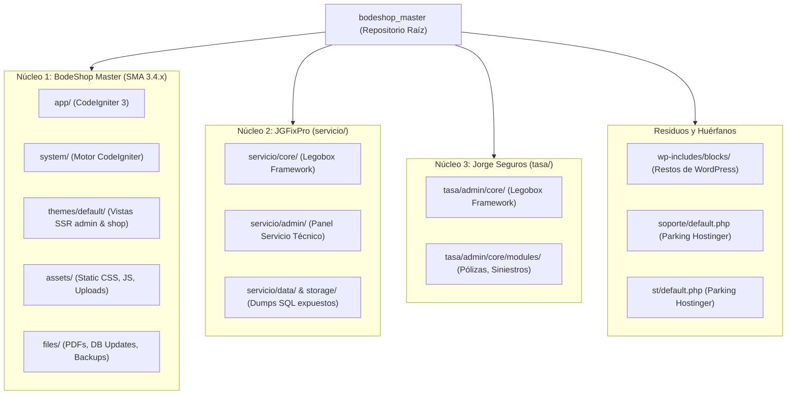
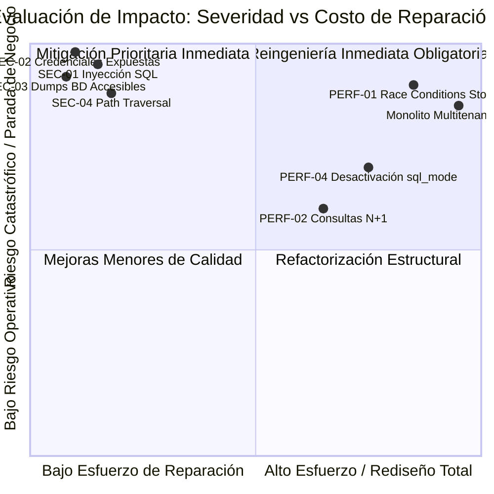

# Auditoría de Arquitectura, Análisis de Sistemas y Evaluación de Seguridad

**Sistema Auditado:** BodeShop Master (Ecosistema Integral de Comercio, POS y Gestión)  
**Fecha de Auditoría:** 24 de Octubre de 2026  
**Rol del Auditor:** Analista de Sistemas Senior y Auditor de Arquitectura de Software  
**Nivel de Clasificación:** Confidencial / Técnico Crítico  
**Ambiente Detectado en Telemetría:** Hostinger Linux Cloud (`/home/u646234231/domains/guslaya.com/public_html/`)  

---

## 1. Resumen Ejecutivo

La presente auditoría exhaustiva sobre el repositorio `bodeshop_master` revela que la base de código actual dista de ser una solución cohesiva moderna. En su lugar, el sistema constituye un **monolito híbrido multitenant accidental ("Frankenstein Repository")**, conformado por la coexistencia de al menos **tres sistemas heredados completamente dispares**, mezclados en el mismo árbol de directorios con herramientas de soporte compartidas y archivos huérfanos de despliegue en hosting compartido (Hostinger).

El núcleo principal se basa en **Stock Manager Advance (SMA) versión 3.4.x**, implementado sobre el framework obsoleto **CodeIgniter 3 (PHP 5.6/7.x)**, acoplado con temas PHP monolíticos con renderizado del lado del servidor (SSR) mezclado con jQuery 2.0.3 (año 2013) y Bootstrap 3. Convivientes con este núcleo se encuentran dos aplicaciones adicionales basadas en un microframework casero ("LegoBox / Evilnapsis"): un sistema de gestión de servicio técnico (`servicio/` - JGFixPro) y un sistema de pólizas de seguros (`tasa/` - Jorge Seguros).

Se han localizado **múltiples vulnerabilidades de severidad CRÍTICA**: inyecciones SQL directas en pantallas de autenticación, exposición pública de backups completos de bases de datos relacionales sin control de acceso, claves maestras de base de datos en texto plano commiteadas en el repositorio, descarga arbitraria de archivos sensibles mediante Path Traversal y ausencia total de controles de concurrencia e integridad en el módulo transaccional de inventario.

---

## 2. Mapeo Topológico y Jerárquico del Ecosistema

La inspección detallada del árbol de directorios revela que el repositorio contiene **3 aplicaciones independientes** y múltiples residuos de infraestructura:



### 2.1 Módulos del Núcleo Principal (BodeShop Master - CodeIgniter 3)
1. **Autenticación e Identidad (`app/controllers/admin/Auth.php`, `app/models/admin/Auth_model.php`):**
   - Basado en biblioteca `Ion Auth`.
   - Manejo de roles estáticos: `Owner`, `Admin`, `Customer`, `Supplier` y permisos granulares `GP` (`permissions`).
2. **Catálogo e Inventario (`Products.php`, `Products_model.php`):**
   - Productos estándar, combos y servicios.
   - Variantes y atributos de productos (`product_variants`, `warehouses_products_variants`).
   - Múltiples almacenes con cálculo agregado de stock (`warehouses_products`).
3. **Punto de Venta POS (`Pos.php`, `Pos_model.php`):**
   - Manejo de registros de caja (`pos_register`).
   - Cuentas suspendidas (`suspended_bills`).
   - Facturación rápida con integración a impresoras térmicas (`mike42/escpos-php`).
4. **Ventas y Facturación (`Sales.php`, `Sales_model.php`):**
   - Flujo de ventas, cotizaciones convertidas (`quotes`), entregas (`deliveries`) y devoluciones (`returns`).
   - Motor de cálculo de costos en cascada (`costing`).
5. **Compras y Proveedores (`Purchases.php`, `Purchases_model.php`):**
   - Órdenes de compra, recepción de mercadería y actualización de existencias.
6. **Tienda Online B2C (`app/controllers/shop/Shop.php`, `Shop_model.php`):**
   - Catálogo e-commerce público, carrito de compra en sesión de CodeIgniter.
   - Pasarelas de pago heredadas: PayPal REST SDK y Stripe PHP SDK v5.x.
7. **APIs REST (`app/controllers/api/v1/`):**
   - Endpoints para `Products`, `Sales`, `Purchases`, `Quotes`, `Transfers`, `Companies`, `Warehouses`.
   - Autenticación básica con keys en cabeceras HTTP mediante `REST_Controller`.

### 2.2 Subsistemas Ajenos Coexistentes
- **`servicio/` (JGFixPro):** Sistema integral de reparación y tickets de servicio técnico para talleres/computación. Utiliza su propia base de datos (`u646234231_servicio`) y modelos independientes (`EstadoData.php`, `reparacion`, `equipo`).
- **`tasa/` (Jorge Seguros):** Disfrazado bajo la carpeta "tasa", este subsistema no es un cotizador de divisas, sino un software completo de correduría de seguros con vistas de pólizas (`polizas`), siniestros (`siniestros`), autos (`autos`), coberturas (`anexo1` a `anexo22`) y comisiones de corredores.
- **`wp-includes/blocks/`:** Residuos de una instalación anterior de WordPress Gutenberg sin funcionalidad en el sistema actual.
- **`soporte/` y `st/`:** Archivos `.php` que contienen páginas estándar generadas por el panel hPanel de Hostinger ("Página por defecto").

---

## 3. Telemetría y Evidencia en Tiempo Real (Logs Locales)

La inspección de los archivos de registro en ejecución ubicados en `app/logs/` (concretamente `log-2026-02-18.php` y `log-2026-02-21.php`) aporta evidencia irrefutable sobre el comportamiento en producción:

1. **Ruta absoluta de despliegue en servidor real:**
   ```
   Severity: Warning --> Invalid argument supplied for foreach() /home/u646234231/domains/guslaya.com/public_html/app/controllers/admin/Calendar.php 128
   ```
   *Evidencia:* El sistema opera en producción bajo el dominio **guslaya.com** en una cuenta compartida de Hostinger (`u646234231`).
2. **Saturación masiva de Logs por errores de I/O y localización:**
   - Cientos de excepciones por segundo del tipo:
     ```
     ERROR - 2026-02-21 19:44:04 --> Could not find the language line "subcategory"
     ERROR - 2026-02-18 11:10:52 --> Could not find the language line "sales_x_delivered"
     ```
   - Causa raíz: Falta de normalización en los diccionarios de internacionalización (`app/language/`), provocando que cada renderizado de página escriba decenas de líneas en disco, degradando drásticamente el rendimiento del almacenamiento en el servidor web.
3. **Manejo deficiente de tipos y arrays nulos:**
   - Warnings continuos de PHP en controladores principales como `Calendar.php` que no verifican si las consultas devuelven arreglos vacíos antes de iterar, resultando en respuestas HTTP 500 intermitentes o interfaces quebradas.

---

## 4. Auditoría de Seguridad: Vulnerabilidades y Brechas Críticas

### Resumen de la Matriz de Riesgo

| ID | Vulnerabilidad / Hallazgo | Ubicación | Severidad | Impacto Primario |
| :--- | :--- | :--- | :---: | :--- |
| **SEC-01** | Inyección SQL Directa (SQLi) en Login | `servicio/admin/login.php`, `tasa/admin/login.php` | **CRÍTICA** | Seguridad (Auth Bypass Total) |
| **SEC-02** | Credenciales Productivas en Código Fuente | `app/config/database.php`, `Database.php`, `Config.php` | **CRÍTICA** | Seguridad (Filtración de DB) |
| **SEC-03** | Dumps de Base de Datos SQL Expuestos Vía Web | `servicio/admin/storage/`, `servicio/data/backup.sql` | **CRÍTICA** | Seguridad (Exfiltración Masiva) |
| **SEC-04** | Descarga Arbitraria de Archivos (Path Traversal) | `app/controllers/admin/Welcome.php::download()` | **CRÍTICA** | Seguridad (Lectura Remota de Código) |
| **SEC-05** | Criptografía Rota y Hashes Débiles (SHA1/MD5) | `app/config/ion_auth.php`, `login.php` | **ALTA** | Seguridad (Robo de Identidades) |
| **SEC-06** | Flags de Cookies Inseguros (`HttpOnly=false`, `Secure=false`) | `app/config/config.php` | **ALTA** | Seguridad (Session Hijacking) |
| **SEC-07** | Dependencias PHP Obsoletas con CVEs Conocidos | `vendor/composer/installed.json` | **ALTA** | Seguridad / Estabilidad (RCE / SSRF) |
| **SEC-08** | Evasión de Protección CSRF en Métodos Clave | `app/config/config.php` | **MEDIA** | Seguridad (Cross-Site Request Forgery) |

---

### Diagnóstico Detallado de Hallazgos de Seguridad

#### SEC-01: Inyección SQL Directa y Evasión Completa de Autenticación
- **Diagnóstico:** En `servicio/admin/login.php` (Línea 12) y `tasa/admin/login.php` (Línea 12), las variables enviadas por el usuario vía `$_POST['email']` son concatenadas sin sanitizar ni parametrizar:
  ```php
  $user = $_POST['email'];
  $pass = sha1(md5($_POST['password']));
  $sql = "select * from user where (nombreUsuario= \"".$user."\" or email= \"".$user."\" ) and password= \"".$pass."\" and estatus=1";
  $query = $con->query($sql);
  ```
- **Riesgo:** **CRÍTICO**. Permite a cualquier usuario no autenticado ingresar una carga maliciosa (payload) como `admin" -- ` o `" OR 1=1 #` en el formulario para iniciar sesión inmediatamente como superadministrador sin conocer la contraseña.
- **Plan de Mitigación Inmediato:** Reemplazar el query crudo por Sentencias Preparadas (`Prepared Statements`) utilizando `mysqli_stmt_bind_param` o PDO.

#### SEC-02: Hardcoding de Credenciales de Base de Datos Productiva
- **Diagnóstico:** Se identificaron contraseñas maestras y nombres de usuario de bases de datos productivas de Hostinger directamente en el repositorio Git:
  - `app/config/database.php`: Usuario `u646234231_principal`, contraseña `Gust.123##` (y previa `m@{=pG@}Q3X(`).
  - `servicio/admin/core/controller/Config.php`: Usuario `u646234231_Servicio`, contraseña `Servicio.123##`, BD `u646234231_servicio`.
  - `tasa/admin/core/controller/Database.php`: Usuario `u646234231_principal`, contraseña `Gust.123##`, con historial de `jorge_seguros` / `fDKWY.K7!{Zs`.
- **Riesgo:** **CRÍTICO**. Cualquier persona con acceso de lectura al repositorio Git o a través de una brecha LFI/Path Traversal posee acceso absoluto e irreversible a la base de datos de clientes, ventas e inventario.
- **Plan de Mitigación Inmediato:**
  1. Revocar y cambiar todas las contraseñas en el panel de control de MySQL de Hostinger de inmediato.
  2. Implementar variables de entorno (`.env`) excluidas del control de versiones (`.gitignore`).
  3. Purgar el historial de Git mediante `git-filter-repo` o `BFG Repo-Cleaner`.

#### SEC-03: Exposición Pública de Backups SQL en Directorios Accesibles por HTTP
- **Diagnóstico:** En el directorio `servicio/data/backup.sql` y `servicio/admin/storage/_backup_*.sql` existen copias de seguridad completas de las bases de datos con estructuras de clientes y empleados. El archivo `.htaccess` en `servicio/admin/` sólo cuenta con `Options All -Indexes`, lo cual **NO bloquea** la descarga directa de archivos si se conoce o deduce el nombre (por ejemplo, `_backup_1750998901.sql`). Además, `servicio/data/` carece por completo de `.htaccess`.
- **Riesgo:** **CRÍTICO**. Permite la descarga directa de los datos personales (cumplimiento GDPR/Habeas Data comprometido), órdenes de trabajo y hashes de usuarios.
- **Plan de Mitigación Inmediato:** Mover los respaldos fuera del directorio raíz web (`public_html`) o agregar de inmediato una regla `Deny from all` en esos subdirectorios.

#### SEC-04: Descarga Arbitraria de Archivos (Path Traversal) en Controlador Admin
- **Diagnóstico:** En `app/controllers/admin/Welcome.php` (Línea 24-30):
  ```php
  public function download($file)
  {
      if (file_exists('./files/' . $file)) {
          $this->load->helper('download');
          force_download('./files/' . $file, null);
          exit();
      }
  ```
  El parámetro `$file` no cuenta con sanitización (`basename()` o `realpath()`).
- **Riesgo:** **CRÍTICO**. Un usuario autenticado con permisos básicos de personal puede invocar:
  `GET /admin/welcome/download/..%2f..%2fapp%2fconfig%2fdatabase.php`
  descargando directamente el código fuente y las credenciales del servidor.
- **Plan de Mitigación Inmediato:** Aplicar `basename($file)` y verificar que la ruta canónica `realpath()` comience estrictamente con la ruta permitida `realpath('./files/')`.

#### SEC-05: Criptografía Débiles y Política Insegura de Contraseñas
- **Diagnóstico:**
  - El sistema principal (`ion_auth.php`) está configurado con `$config['hash_method'] = 'sha1';`. SHA-1 es un algoritmo criptográficamente roto desde 2005.
  - La expiración de tokens de recuperación de contraseña está deshabilitada: `$config['forgot_password_expiration'] = 0;`, lo que significa que un enlace de restablecimiento de contraseña generado una vez es válido indefinidamente.
  - En los subsistemas satélites, las contraseñas se almacenan mediante `sha1(md5($password))`, sin salt y vulnerable a ataques directos mediante tablas Rainbow.
- **Riesgo:** **ALTO**. Exfiltraciones de base de datos permiten descifrar de manera instantánea el 100% de las contraseñas de los usuarios.
- **Plan de Mitigación Inmediato:** Cambiar `hash_method` a `bcrypt` o `argon2id` con salts dinámicos y configurar expiración de token de restablecimiento de máximo 15 minutos.

#### SEC-06: Configuración Vulnerable de Sesiones y Cookies
- **Diagnóstico:** En `app/config/config.php`:
  ```php
  $config['cookie_secure']   = false;
  $config['cookie_httponly'] = false;
  $config['sess_match_ip']   = false;
  ```
- **Riesgo:** **ALTO**. Al tener `cookie_httponly = false`, cualquier script JavaScript malicioso inyectado (XSS) tiene lectura directa de las cookies de sesión del usuario. Al no exigir HTTPS (`cookie_secure = false`), las cookies viajan en texto claro si no se fuerza HSTS.
- **Plan de Mitigación Inmediato:** Establecer `cookie_httponly = true;`, `cookie_secure = true;` y activar la regeneración periódica de tokens de sesión.

#### SEC-07: Dependencias de Terceros Desactualizadas con Vulnerabilidades RCE/SSRF
- **Diagnóstico:** Inspección del catálogo en `vendor/composer/installed.json`:
  - `dompdf/dompdf (v0.8.5)`: Afectado por vulnerabilidades conocidas de Ejecución Remota de Código (RCE) y SSRF a través de inyección de fuentes CSS y URIs maliciosas (CVE-2022-28368, CVE-2023-23924).
  - `guzzlehttp/guzzle (6.5.5)`: Vulnerable a desvío de cabeceras de autorización y fugas de cookies (CVE-2022-31090, CVE-2022-31091).
  - `stripe/stripe-php (v5.9.2)` y `paypal/rest-api-sdk-php (1.14.0)`: Bibliotecas oficialmente deprecadas que no cumplen con los estándares actuales de seguridad bancaria PCI-DSS v4.0.
  - `jquery-2.0.3`: Obsoleto con vectores de XSS y Prototype Pollution en el frontend.
- **Riesgo:** **ALTO**. Permite a actores maliciosos comprometer la máquina servidora o realizar falsificaciones de pagos.
- **Plan de Mitigación Inmediato:** Actualizar a versiones mantenidas y migrar los SDKs de pago a APIs modernas basadas en Webhooks firmados con HMAC.

---

## 5. Auditoría de Arquitectura, Rendimiento y Concurrencia

### 5.1 Condiciones de Carrera en el Control de Existencias (Race Conditions)
En `app/models/Site.php`, el mecanismo de sincronización de inventario (`syncQuantity`, `syncProductQty`, `syncVariantQty`) funciona bajo el siguiente flujo:
1. Lee todas las transacciones históricas (`getAllSaleItems`, `getAllPurchaseItems`).
2. Calcula en memoria de PHP el saldo actual: `$balance = $this->getBalanceQuantity(...)`.
3. Ejecuta una actualización ciega: `$this->db->update('products', ['quantity' => $balance], ...)`.

**Impacto:**
- **Escalabilidad:** Muy deficiente. A medida que la tabla `sale_items` y `purchase_items` crece con los años, cada venta requiere computar sumas masivas en la base de datos.
- **Concurrencia:** **CERO TOLERANCIA A CONCURRENCIA**. Si dos cajeros en el POS o un comprador online y un cajero presencial venden el último ítem al mismo tiempo:
  - Ambos procesos leen el mismo stock (`quantity = 1`).
  - Ambos calculan que queda stock suficiente.
  - Ambos descuentan y persisten.
  - Resultado: **Sobrevendimiento (Overselling) y saldos negativos no controlados**.
- **Falta de Bloqueos:** No se utiliza `SELECT ... FOR UPDATE` ni operaciones atómicas (`UPDATE products SET quantity = quantity - ? WHERE id = ? AND quantity >= ?`).

### 5.2 Problema de Consultas N+1 en las APIs REST
En `app/controllers/api/v1/Products.php`:
```php
foreach ($products as $product) {
    if ($include == 'brand') { $product->brand = $this->products_api->getBrandByID($product->brand); }
    if ($include == 'category') { $product->category = $this->products_api->getCategoryByID($product->category); }
    if ($include == 'photos') { $product->photos = $this->products_api->getProductPhotos($product->id); }
}
```
Para una lista de 50 productos con filtros de marca, categoría y fotos, el controlador ejecuta:
`1 (consulta inicial) + 50 (marca) + 50 (categoría) + 50 (fotos) = 151 consultas SQL individuales.`  
Esto genera saturación del pool de conexiones de MySQL y latencias de respuesta superiores a 2.5 segundos por petición.

### 5.3 Sobrecarga de I/O en la Construcción de Vistas (`page_construct`)
En `MY_Controller.php` (Líneas 120-123), **cada recarga de página** en el panel de administración ejecuta automáticamente:
- `get_total_qty_alerts()`
- `get_expiring_qty_alerts()`
- `get_shop_sale_alerts()`
- `get_shop_payment_alerts()`

Estas 4 consultas ejecutan `COUNT(*)` sobre tablas no indexadas para mostrar insignias numéricas en la cabecera. En una jornada con 10 cajeros y administradores navegando, se disparan miles de consultas agregadas innecesarias por hora sobre el motor MySQL.

### 5.4 Desactivación de Modos Estrictos de MySQL
En `MY_Controller.php` (Línea 10):
```php
$this->db->query('SET SESSION sql_mode = ""');
```
El sistema fuerza de forma deliberada el vaciado de todas las directivas de integridad del motor SQL (`STRICT_TRANS_TABLES`, `NO_ZERO_IN_DATE`, `ONLY_FULL_GROUP_BY`).
- **Consecuencia:** MySQL trunca textos silenciosamente si exceden el tamaño de la columna, inserta ceros en campos obligatorios no enviados y permite agrupaciones ambiguas en balances financieros, imposibilitando la cuadratura contable formal.

---

## 6. Evaluación de Impacto Integral



1. **Escalabilidad:** El sistema no admite escalado horizontal. Las sesiones se guardan en la tabla `sma_sessions` de MySQL o en archivos de disco locales; no hay soporte para réplicas de lectura, balanceadores de carga sin persistencia ni desacoplamiento de almacenamiento estático (archivos subidos directamente al servidor local en `assets/uploads/`).
2. **Seguridad:** Críticamente comprometida. El sistema suspende cualquier estándar de seguridad básica: passwords en SHA1/MD5, SQL injections triviales sin autenticación en módulos satélites, backups descargables por HTTP y path traversal en descargas administrativas.
3. **Mantenibilidad:** El código es insostenible a largo plazo. Existen controladores con más de 2,800 líneas de código procedural mezclado con SQL crudo, plantillas PHP sin escapar (`echo $var` directo), ausencia total de pruebas automatizadas (tests unitarios/E2E) y librerías de soporte que no corren de manera nativa en PHP 8.2+.

---

## 7. Plan de Mitigación Inmediato (Pre-Migración)

Antes de iniciar la migración definitiva, deben ejecutarse las siguientes acciones de contención en el servidor actual:

1. **Paso 1: Parchear Inyección SQL en satélites:**
   Modificar `servicio/admin/login.php` y `tasa/admin/login.php` para utilizar `prepare()` y `bind_param()` o deshabilitar dichos subdirectorios si no están siendo utilizados por el negocio.
2. **Paso 2: Bloquear Acceso a Archivos SQL y Backups:**
   Añadir de inmediato en la raíz de `servicio/` y `servicio/admin/storage/` un archivo `.htaccess`:
   ```apache
   Order Deny,Allow
   Deny from all
   ```
3. **Paso 3: Rotación Forzosa de Credenciales de Base de Datos:**
   Cambiar de inmediato la contraseña del usuario `u646234231_principal` en Hostinger y actualizar `app/config/database.php`.
4. **Paso 4: Parchear Path Traversal en `Welcome.php`:**
   Envolver el parámetro `$file` con `basename($file)` y verificar que no contenga secuencias de directorios relativos (`..`).
5. **Paso 5: Forzar Cookies HTTPOnly:**
   Modificar `app/config/config.php` cambiando `$config['cookie_httponly'] = true;` y `$config['cookie_secure'] = true;`.
