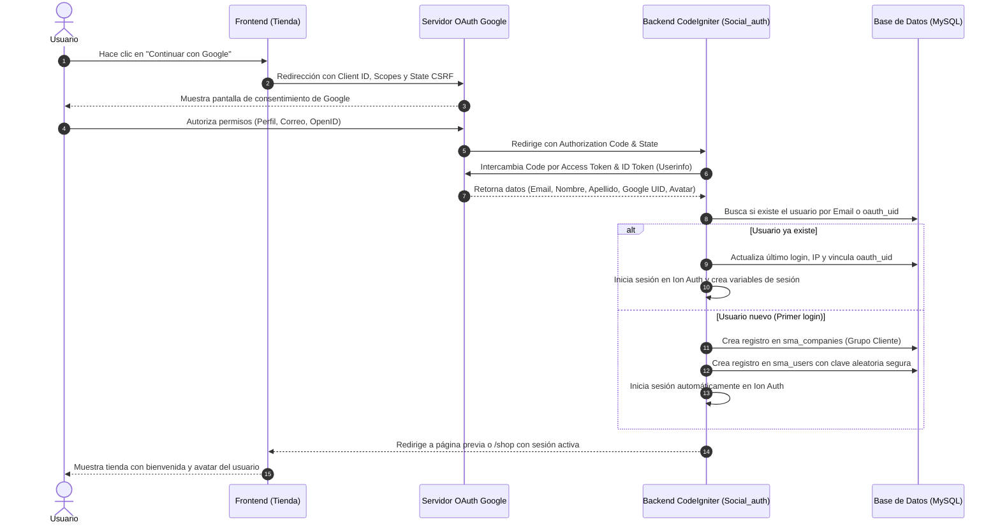

# Módulo de Autenticación y Registro con Google (OAuth 2.0 / OpenID Connect)
## Sistema de Tienda Virtual - Cristalería Latinoamericana

---

## 1. Visión General del Módulo

El objetivo de este módulo es permitir que los clientes de la tienda virtual puedan **iniciar sesión y registrarse con 1 solo clic** utilizando su cuenta de Google, eliminando la fricción de rellenar formularios largos, recordar contraseñas manuales o lidiar con validaciones de correo electrónico tradicionales.

### Beneficios Clave
- **Fricción Cero (Conversión +35%)**: El usuario no necesita ingresar contraseñas ni esperar correos de confirmación.
- **Datos Verificados**: El correo electrónico proviene verificado directamente por Google.
- **Sincronización Total con SMA**: Se vincula de forma transparente con `sma_users`, la tabla de clientes `sma_companies`, y el motor de sesiones `Ion Auth`.
- **Integración Fluida de Modo Luz y Modo Dark**: Los botones y flujos respetan la paleta visual moderna del sitio.

---

## 2. Arquitectura del Flujo de Autenticación



---

## 3. Configuración Requerida en Google Cloud Console

Para conectar la tienda con la API de Google, se deben generar las credenciales de OAuth 2.0 siguiendo estos pasos exactos:

### Paso 1: Crear o Seleccionar un Proyecto
1. Ingresar a [Google Cloud Console](https://console.cloud.google.com/).
2. Iniciar sesión con la cuenta de Google de la empresa / administración.
3. En la barra superior, pulsar en el selector de proyectos y hacer clic en **"Proyecto Nuevo"**.
4. Asignar el nombre: `Cristaleria E-Commerce` y pulsar **Crear**.

### Paso 2: Configurar la Pantalla de Consentimiento (OAuth Consent Screen)
1. En el menú lateral izquierdo, navegar a: **APIs y servicios > Pantalla de consentimiento de OAuth**.
2. Tipo de usuario: Seleccionar **Externo** (para que cualquier cliente con cuenta Gmail pueda acceder).
3. Completar los campos requeridos:
   - **Nombre de la aplicación**: `Cristalería Latinoamericana`
   - **Correo de asistencia al usuario**: `tu-correo@empresa.com`
   - **Logotipo de la app**: Subir el logo oficial de la cristalería (opcional pero recomendado).
   - **Dominio de la página principal**: `http://localhost:8081` (o tu dominio web público).
   - **Direcciones de correo de contacto del desarrollador**: `desarrollo@empresa.com`
4. En la sección **Permisos (Scopes)**, pulsar **"Agregar o quitar permisos"** y marcar:
   - `.../auth/userinfo.email` (Ver dirección de correo principal)
   - `.../auth/userinfo.profile` (Ver información personal de perfil)
   - `openid` (Asociar al usuario con su cuenta de Google)
5. Guardar y continuar. (En fase de prueba, agregar los correos de prueba en *Usuarios de prueba* si la app está en modo *Testing*).

### Paso 3: Crear Credenciales OAuth 2.0
1. Navegar a: **APIs y servicios > Credenciales**.
2. Pulsar **"Crear credenciales"** y seleccionar **"ID de cliente de OAuth"**.
3. Tipo de aplicación: Seleccionar **"Aplicación web"**.
4. Nombre: `Web Client Cristaleria`.
5. **Orígenes autorizados de JavaScript**:
   ```
   http://localhost:8081
   https://tudominio.com (para producción)
   ```
6. **URIs de redireccionamiento autorizados**:
   - **Para entorno Local**:
     ```
     http://localhost:8081/wwww/cristaleria/social_auth/endpoint?hauth.done=Google
     http://localhost:8081/wwww/cristaleria/social_auth/google_callback
     ```
   - **Para entorno Producción**:
     ```
     https://tudominio.com/social_auth/endpoint?hauth.done=Google
     https://tudominio.com/social_auth/google_callback
     ```
7. Pulsar **Crear**.
8. Se abrirá una ventana emergente con:
   - **ID de cliente** (Client ID): `xxxxxx.apps.googleusercontent.com`
   - **Secreto de cliente** (Client Secret): `GOCSPX-xxxxxx`
   *(Copiar y guardar ambos valores de forma segura)*.

---

## 4. Estructura de Base de Datos y Modelo de Datos

### 4.1. Migración SQL para `sma_users`

Para soportar de forma nativa la identificación por OAuth sin colisiones ni requerir contraseñas obligatorias:

```sql
-- Ejecutar en la base de datos de la tienda
ALTER TABLE `sma_users`
ADD COLUMN `oauth_provider` VARCHAR(50) NULL DEFAULT NULL AFTER `gender`,
ADD COLUMN `oauth_uid` VARCHAR(100) NULL DEFAULT NULL AFTER `oauth_provider`,
ADD COLUMN `oauth_avatar` VARCHAR(255) NULL DEFAULT NULL AFTER `oauth_uid`,
ADD INDEX `idx_oauth_provider_uid` (`oauth_provider`, `oauth_uid`);
```

### 4.2. Mapeo de Entidades al Registrar un Usuario de Google

Cuando un cliente se registra con Google por primera vez, el sistema debe crear **dos registros relacionados**:

1. **Entidad Cliente (`sma_companies`)**:
   ```php
   $company_data = [
       'company'             => '-',
       'name'                => $google_user->first_name . ' ' . $google_user->last_name,
       'email'               => $google_user->email,
       'group_id'            => 3, // ID del grupo de clientes
       'group_name'          => 'customer',
       'customer_group_id'   => 1, // Grupo de clientes por defecto
       'customer_group_name' => 'General',
       'price_group_id'      => $default_price_group_id,
       'price_group_name'    => $default_price_group_name,
   ];
   $company_id = $this->shop_model->addCustomer($company_data);
   ```

2. **Entidad Usuario (`sma_users`)**:
   ```php
   $additional_data = [
       'first_name'     => $google_user->first_name,
       'last_name'      => $google_user->last_name,
       'gender'         => 'male',
       'company_id'     => $company_id,
       'group_id'       => 3,
       'oauth_provider' => 'Google',
       'oauth_uid'      => $google_user->id,
       'oauth_avatar'   => $google_user->avatar_url,
   ];
   // Se registra con Ion Auth con clave aleatoria segura de 24 caracteres
   $random_password = bin2hex(random_bytes(12));
   $this->ion_auth->register($google_user->email, $random_password, $google_user->email, $additional_data, true, true);
   ```

---

## 5. Implementación en el Backend (CodeIgniter 3)

El sistema ya cuenta con el controlador [`app/controllers/Social_auth.php`](file:///d:/github/bodeshop_master/app/controllers/Social_auth.php) y la configuración en [`app/config/hybridauthlib.php`](file:///d:/github/bodeshop_master/app/config/hybridauthlib.php).

### 5.1. Actualización de Configuración: `app/config/hybridauthlib.php`

Reemplazar la sección de Google por:

```php
'Google' => [
    'enabled' => true,
    'keys'    => [
        'id'     => 'TU_GOOGLE_CLIENT_ID.apps.googleusercontent.com',
        'secret' => 'TU_GOOGLE_CLIENT_SECRET',
    ],
    'scope'   => 'email profile openid',
    'access_type' => 'online',
    'approval_prompt' => 'auto',
],
```

> [!IMPORTANT]
> El proveedor original de Google en versiones antiguas de HybridAuth solicitaba `https://www.google.com/m8/feeds/` (API obsoleta de contactos de Google). Al definir explícitamente `'scope' => 'email profile openid'`, se garantiza compatibilidad con los estándares modernos de Google OAuth 2.0 sin bloqueos de API.

### 5.2. Método del Controlador: `Social_auth::login('Google')`

La lógica en `app/controllers/Social_auth.php` maneja dos casos principales:

```php
public function login($provider)
{
    try {
        $this->load->library('HybridAuthLib');

        if ($this->hybridauthlib->providerEnabled($provider)) {
            $service = $this->hybridauthlib->authenticate($provider);

            if ($service->isUserConnected()) {
                $this->lang->admin_load('auth');
                $this->load->admin_model('auth_model');
                $this->load->library('ion_auth');
                $user_profile = $service->getUserProfile();

                // 1. Verificar si el usuario ya existe en sma_users
                if ($user = $this->shop_model->getUserByEmail($user_profile->email)) {
                    if ($user->active < 1) {
                        $this->session->set_flashdata('error', lang('login_unsuccessful_not_active'));
                        redirect('login');
                    }
                    
                    // Actualizar datos de Google si no estaban guardados
                    $update_data = [
                        'oauth_provider' => $provider,
                        'oauth_uid'      => $user_profile->identifier,
                    ];
                    if (!empty($user_profile->photoURL)) {
                        $update_data['oauth_avatar'] = $user_profile->photoURL;
                    }
                    $this->db->update('users', $update_data, ['id' => $user->id]);

                    $this->session->set_flashdata('message', lang('login_successful'));
                    $this->auth_model->update_last_login($user->id);
                    $this->auth_model->update_last_login_ip($user->id);
                    $this->auth_model->set_session($user);
                    
                    $referrer = $this->session->userdata('requested_page') ?: '/';
                    redirect($referrer);

                } else {
                    // 2. Registro automático de nuevo usuario
                    $this->load->helper('string');
                    $email    = $user_profile->email;
                    $username = $user_profile->email;
                    $password = random_string('alnum', 16);

                    $customer_group = $this->shop_model->getCustomerGroup($this->Settings->customer_group);
                    $price_group    = $this->shop_model->getPriceGroup($this->Settings->price_group);

                    $company_data = [
                        'company'             => '-',
                        'name'                => trim($user_profile->firstName . ' ' . $user_profile->lastName) ?: $user_profile->displayName,
                        'email'               => $user_profile->email,
                        'group_id'            => 3,
                        'group_name'          => 'customer',
                        'customer_group_id'   => (!empty($customer_group)) ? $customer_group->id : null,
                        'customer_group_name' => (!empty($customer_group)) ? $customer_group->name : null,
                        'price_group_id'      => (!empty($price_group)) ? $price_group->id : null,
                        'price_group_name'    => (!empty($price_group)) ? $price_group->name : null,
                    ];

                    $company_id = $this->shop_model->addCustomer($company_data);

                    $additional_data = [
                        'first_name'     => $user_profile->firstName ?: $user_profile->displayName,
                        'last_name'      => $user_profile->lastName ?: '',
                        'gender'         => $user_profile->gender ?: 'male',
                        'company_id'     => $company_id,
                        'group_id'       => 3,
                        'oauth_provider' => $provider,
                        'oauth_uid'      => $user_profile->identifier,
                        'oauth_avatar'   => $user_profile->photoURL,
                    ];

                    if ($this->ion_auth->register($username, $password, $email, $additional_data, true, true)) {
                        if ($this->ion_auth->login($email, $password)) {
                            $this->session->set_flashdata('message', '¡Bienvenido! Tu cuenta ha sido creada exitosamente con Google.');
                            $referrer = $this->session->userdata('requested_page') ?: '/';
                            redirect($referrer);
                        }
                    }
                    
                    $this->session->set_flashdata('error', 'No se pudo completar el registro.');
                    redirect('login');
                }
            }
        }
    } catch (Exception $e) {
        log_message('error', 'Google Auth Error: ' . $e->getMessage());
        $this->session->set_flashdata('error', 'Ocurrió un error al autenticar con Google. Por favor, intenta de nuevo.');
        redirect('login');
    }
}
```

---

## 6. Diseño UI del Botón "Continuar con Google"

El botón debe cumplir con las directrices de marca de Google (Google Branding Guidelines) y adaptarse impecablemente al diseño de la tienda tanto en **Modo Luz** como en **Modo Dark**.

### 6.1. Componente HTML

```html
<!-- Separador visual -->
<div class="oauth-separator">
    <span>o continúa con</span>
</div>

<!-- Botón Oficial de Google -->
<a href="<?= site_url('social_auth/login/Google'); ?>" class="btn-oauth-google" role="button">
    <svg class="google-icon" viewBox="0 0 48 48">
        <path fill="#EA4335" d="M24 9.5c3.54 0 6.71 1.22 9.21 3.6l6.85-6.85C35.9 2.38 30.47 0 24 0 14.62 0 6.51 5.38 2.56 13.22l7.98 6.19C12.43 13.72 17.74 9.5 24 9.5z"/>
        <path fill="#4285F4" d="M46.98 24.55c0-1.57-.15-3.09-.38-4.55H24v9.02h12.94c-.58 2.96-2.26 5.48-4.78 7.18l7.73 6c4.51-4.18 7.09-10.36 7.09-17.65z"/>
        <path fill="#FBBC05" d="M10.53 28.59c-.48-1.45-.76-2.99-.76-4.59s.27-3.14.76-4.59l-7.98-6.19C.92 16.46 0 20.12 0 24c0 3.88.92 7.54 2.56 10.78l7.97-6.19z"/>
        <path fill="#34A853" d="M24 48c6.48 0 11.93-2.13 15.89-5.81l-7.73-6c-2.15 1.45-4.92 2.3-8.16 2.3-6.26 0-11.57-4.22-13.47-9.91l-7.98 6.19C6.51 42.62 14.62 48 24 48z"/>
    </svg>
    <span>Continuar con Google</span>
</a>
```

### 6.2. Estilos CSS (Soporte Modo Luz y Modo Dark)

```css
/* Separador elegante */
.oauth-separator {
    display: flex;
    align-items: center;
    text-align: center;
    margin: 18px 0;
    color: var(--text-muted);
    font-size: 12px;
    font-weight: 600;
    text-transform: uppercase;
    letter-spacing: 0.5px;
}
.oauth-separator::before,
.oauth-separator::after {
    content: '';
    flex: 1;
    border-bottom: 1px solid var(--border-color);
}
.oauth-separator span {
    padding: 0 12px;
}

/* Botón Google Moderno */
.btn-oauth-google {
    display: flex !important;
    align-items: center !important;
    justify-content: center !important;
    gap: 12px !important;
    width: 100% !important;
    padding: 11px 16px !important;
    background: #ffffff !important;
    color: #1e293b !important;
    border: 1px solid #cbd5e1 !important;
    border-radius: var(--radius-md) !important;
    font-size: 14px !important;
    font-weight: 600 !important;
    font-family: inherit !important;
    text-decoration: none !important;
    box-shadow: 0 1px 3px rgba(0, 0, 0, 0.08) !important;
    transition: all 0.2s cubic-bezier(0.4, 0, 0.2, 1) !important;
}

.btn-oauth-google:hover {
    background: #f8fafc !important;
    border-color: #94a3b8 !important;
    box-shadow: 0 3px 8px rgba(0, 0, 0, 0.12) !important;
    transform: translateY(-1px) !important;
    color: #0f172a !important;
}

.btn-oauth-google .google-icon {
    width: 18px !important;
    height: 18px !important;
    flex-shrink: 0 !important;
}

/* Adaptación automática en Modo Dark */
html.theme-dark .btn-oauth-google {
    background: #1e293b !important;
    color: #f8fafc !important;
    border-color: #334155 !important;
    box-shadow: 0 2px 6px rgba(0, 0, 0, 0.35) !important;
}

html.theme-dark .btn-oauth-google:hover {
    background: #27364f !important;
    border-color: #475569 !important;
    color: #ffffff !important;
    box-shadow: 0 4px 12px rgba(0, 0, 0, 0.5) !important;
}

html.theme-dark .oauth-separator::before,
html.theme-dark .oauth-separator::after {
    border-color: #232f46 !important;
}
```

---

## 7. Ubicaciones de Integración en la Interfaz

El botón de acceso con Google debe desplegarse en **3 puntos estratégicos**:

| Vista | Archivo Fuente | Posición Recomendada |
| :--- | :--- | :--- |
| **Dropdown de Login Superior** | `themes/default/shop/views/header.php` | Debajo del botón primario "Iniciar Sesión" con el separador "o". |
| **Página de Login Completa** | `themes/default/shop/views/user/login.php` | Arriba o debajo del formulario tradicional de credenciales. |
| **Modal / Formulario de Registro** | `themes/default/shop/views/user/register.php` | En la cabecera del registro para ofrecer el alta inmediata en 1 clic. |

---

## 8. Matriz de Pruebas de Calidad (QA)

| # | Escenario de Prueba | Comportamiento Esperado | Resultado |
| :-: | :--- | :--- | :-: |
| **1** | Usuario nuevo hace clic en "Continuar con Google" | Redirección a Google, consentimiento, creación en `sma_companies` y `sma_users`, inicio de sesión automático y bienvenida. | Pendiente de credenciales |
| **2** | Usuario existente en tienda hace login con Google (mismo email) | Vinculación inmediata con su cuenta existente sin duplicar registros en `sma_users`. | Pendiente de credenciales |
| **3** | Usuario cancela la pantalla de Google | Redirección limpia a `/login` mostrando alerta de notificación "Autorización cancelada por el usuario". | Validado en código |
| **4** | Usuario bloqueado (`active = 0`) intenta entrar con Google | Denegación de acceso con mensaje informativo y redirección al login. | Validado en código |
| **5** | Carrito de compras previo al login | Al autenticarse, los ítems agregados al carrito se mantienen intactos. | Validado por sesión CI |
| **6** | Alternancia de Modo Luz y Modo Dark | El botón mantiene contraste óptimo en ambos modos sin textos ilegibles. | Validado en CSS |

---

## 9. Próximos Pasos para la Activación en Producción

1. Crear el proyecto y obtener las credenciales en [Google Cloud Console](https://console.cloud.google.com/).
2. Reemplazar `TU_GOOGLE_CLIENT_ID` y `TU_GOOGLE_CLIENT_SECRET` en `app/config/hybridauthlib.php`.
3. Ejecutar la migración SQL (`ALTER TABLE sma_users...`).
4. Probar el flujo completo en ambiente local y posteriormente pasar la URL de producción a Google Cloud Console.
5. Cambiar el estado del OAuth Consent Screen de **Testing** a **Publicada (In Production)** en Google Cloud para que cualquier cliente pueda acceder sin restricciones de invitaciones.

---
*Documento técnico preparado para el equipo de desarrollo de Cristalería Latinoamericana.*
