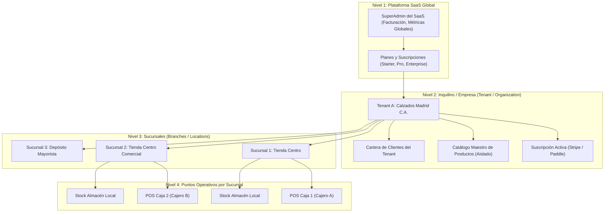
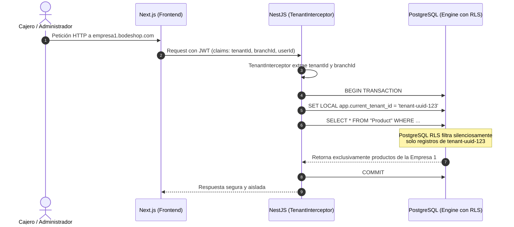
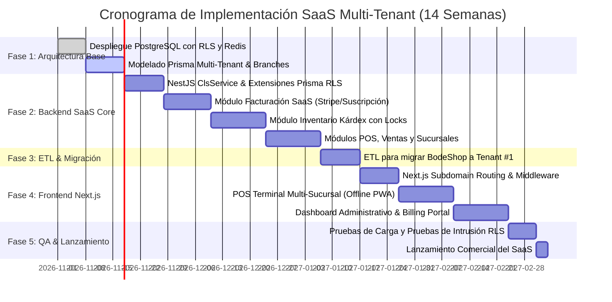

# Plan Maestro de Migración: SaaS Multi-Tenant y Multi-Sucursal (NestJS, Next.js y PostgreSQL)

**Sistema Origen:** BodeShop Master (PHP CodeIgniter 3 + Legobox)  
**Sistema Destino:** Plataforma SaaS Multi-Tenant y Multi-Sucursal (B2B SaaS)  
**Stack Tecnológico:** NestJS (Backend) + Next.js App Router (Frontend) + PostgreSQL 16+ con RLS + Redis 7  
**Fecha:** 24 de Octubre de 2026  
**Autor:** Analista de Sistemas Senior y Auditor de Arquitectura de Software  

---

## 1. Visión y Estrategia del SaaS Multi-Tenant

El nuevo ecosistema se transformará de una aplicación aislada para un único comercio en una **Plataforma SaaS B2B Multinquilino (Multi-Tenant) y Multi-Sucursal (Multi-Branch)** capaz de comercializar suscripciones recurrentes a cualquier empresa comercializadora.

### Requerimientos Fundamentales del Negocio SaaS:
1. **Aislamiento Absoluto de Datos (Data Isolation):** La Empresa "A" jamás podrá leer, modificar, listar ni comercializar los productos, clientes, compras o ventas de la Empresa "B".
2. **Estructura Jerárquica de Sucursales (Branch Engine):** Cada empresa cliente (Tenant) puede operar una o múltiples sucursales físicas (tiendas, depósitos, puntos de venta remotos), con inventarios independientes por almacén, cajas registradoras aisladas y reportes consolidados a nivel corporativo.
3. **Motor de Monetización y Suscripciones (SaaS Billing & Quotas):** Cobro recurrente de planes (e.g. Starter, Profesional, Enterprise) con límites forzados por código (número de sucursales, terminales POS, catálogo de productos y volumen de facturación).

---

## 2. Jerarquía del Modelo de Dominio SaaS



---

## 3. Estrategia de Aislamiento de Datos en PostgreSQL

Para garantizar aislamiento del 100% sin el sobrecosto inmanejable de mantener miles de bases de datos separadas, se implementa el patrón **Shared Database, Shared Schema con Row-Level Security (RLS) nativo de PostgreSQL** y ClsService en NestJS.

### ¿Por qué Row-Level Security (RLS)?
- En una arquitectura tradicional, si un desarrollador olvida agregar `where: { tenantId }` en una consulta de Prisma o TypeORM, se produce una **fuga masiva de datos (Data Leak)** entre competidores.
- Con **PostgreSQL RLS**, el propio motor de la base de datos bloquea a nivel de kernel cualquier registro cuyo `tenant_id` no coincida con la variable de sesión actual (`app.current_tenant_id`). Ninguna consulta puede vulnerar la privacidad de otro inquilino, ni siquiera por error humano.



---

## 4. Esquema Relacional de Base de Datos (Prisma DDL)

Este esquema soporta planes SaaS, suscripciones, empresas (tenants), sucursales (branches), almacenes, catálogo aislado, inventario Kárdex con bloqueos pesimistas y registros de caja POS:

```prisma
datasource db {
  provider = "postgresql"
  url      = env("DATABASE_URL")
}

generator client {
  provider = "prisma-client-js"
}

// ====================================================
// PLATAFORMA SAAS Y FACTURACIÓN DE SUSCRIPCIONES
// ====================================================

enum SubscriptionStatus {
  TRIAL
  ACTIVE
  PAST_DUE
  CANCELLED
  UNPAID
}

enum BillingCycle {
  MONTHLY
  YEARLY
}

model SaaSPlan {
  id              String         @id @default(uuid()) @db.Uuid
  code            String         @unique @db.VarChar(50) // 'starter', 'pro', 'enterprise'
  name            String         @db.VarChar(100)
  description     String?        @db.Text
  priceMonthly    Decimal        @db.Decimal(10, 2)
  priceYearly     Decimal        @db.Decimal(10, 2)
  maxBranches     Int            @default(1)    // Límite de sucursales
  maxWarehouses   Int            @default(1)    // Límite de almacenes
  maxUsers        Int            @default(2)    // Límite de empleados
  maxProducts     Int            @default(500)  // Límite de catálogo
  hasAdvancedReports Boolean     @default(false)
  hasApiAccess    Boolean        @default(false)
  subscriptions   Subscription[]
  createdAt       DateTime       @default(now())
  updatedAt       DateTime       @updatedAt
}

model Tenant {
  id              String         @id @default(uuid()) @db.Uuid
  slug            String         @unique @db.VarChar(100) // Subdominio: 'calzados-madrid'
  legalName       String         @db.VarChar(200)
  tradeName       String         @db.VarChar(200)
  taxId           String         @db.VarChar(50)  // RIF, RUT, CIF, NIF
  email           String         @unique @db.VarChar(150)
  phone           String?        @db.VarChar(50)
  isActive        Boolean        @default(true)
  subscription    Subscription?
  branches        Branch[]
  users           User[]
  categories      Category[]
  products        Product[]
  customers       Customer[]
  suppliers       Supplier[]
  sales           Sale[]
  purchases       Purchase[]
  createdAt       DateTime       @default(now())
  updatedAt       DateTime       @updatedAt

  @@index([slug])
}

model Subscription {
  id                   String             @id @default(uuid()) @db.Uuid
  tenantId             String             @unique @db.Uuid
  tenant               Tenant             @relation(fields: [tenantId], references: [id], onDelete: Cascade)
  planId               String             @db.Uuid
  plan                 SaaSPlan           @relation(fields: [planId], references: [id])
  status               SubscriptionStatus @default(TRIAL)
  billingCycle         BillingCycle       @default(MONTHLY)
  currentPeriodStart   DateTime           @default(now())
  currentPeriodEnd     DateTime
  stripeCustomerId     String?            @db.VarChar(100)
  stripeSubscriptionId String?            @db.VarChar(100)
  cancelAtPeriodEnd    Boolean            @default(false)
  createdAt            DateTime           @default(now())
  updatedAt            DateTime           @updatedAt
}

// ====================================================
// SUCURSALES (BRANCHES) Y ESTRUCTURA OPERATIVA
// ====================================================

model Branch {
  id              String         @id @default(uuid()) @db.Uuid
  tenantId        String         @db.Uuid
  tenant          Tenant         @relation(fields: [tenantId], references: [id], onDelete: Cascade)
  code            String         @db.VarChar(50) // 'SUC-01', 'SUC-CENTRO'
  name            String         @db.VarChar(150)
  address         String         @db.Text
  city            String         @db.VarChar(100)
  state           String?        @db.VarChar(100)
  phone           String?        @db.VarChar(50)
  isMain          Boolean        @default(false)
  isActive        Boolean        @default(true)
  warehouses      Warehouse[]
  posRegisters    PosRegister[]
  sales           Sale[]
  userAssignments UserBranch[]
  createdAt       DateTime       @default(now())
  updatedAt       DateTime       @updatedAt

  @@unique([tenantId, code])
  @@index([tenantId])
}

model Warehouse {
  id              String         @id @default(uuid()) @db.Uuid
  tenantId        String         @db.Uuid
  branchId        String         @db.Uuid
  branch          Branch         @relation(fields: [branchId], references: [id], onDelete: Cascade)
  code            String         @db.VarChar(50)
  name            String         @db.VarChar(150)
  address         String?        @db.Text
  stocks          WarehouseStock[]
  stockMovements  StockMovement[]
  createdAt       DateTime       @default(now())
  updatedAt       DateTime       @updatedAt

  @@unique([tenantId, branchId, code])
  @@index([tenantId, branchId])
}

// ====================================================
// USUARIOS, ROLES Y ACCESO POR SUCURSAL
// ====================================================

enum Role {
  TENANT_OWNER
  TENANT_ADMIN
  BRANCH_MANAGER
  CASHIER
  INVENTORY_CLERK
}

model User {
  id              String         @id @default(uuid()) @db.Uuid
  tenantId        String         @db.Uuid
  tenant          Tenant         @relation(fields: [tenantId], references: [id], onDelete: Cascade)
  email           String         @db.VarChar(150)
  passwordHash    String
  firstName       String         @db.VarChar(100)
  lastName        String         @db.VarChar(100)
  role            Role           @default(CASHIER)
  isActive        Boolean        @default(true)
  branchAccess    UserBranch[]
  sales           Sale[]
  posRegisters    PosRegister[]
  stockMovements  StockMovement[]
  createdAt       DateTime       @default(now())
  updatedAt       DateTime       @updatedAt

  @@unique([tenantId, email])
  @@index([tenantId, email])
}

model UserBranch {
  id              String         @id @default(uuid()) @db.Uuid
  userId          String         @db.Uuid
  user            User           @relation(fields: [userId], references: [id], onDelete: Cascade)
  branchId        String         @db.Uuid
  branch          Branch         @relation(fields: [branchId], references: [id], onDelete: Cascade)
  isDefault       Boolean        @default(false)

  @@unique([userId, branchId])
}

// ====================================================
// CATÁLOGO AISLADO POR TENANT
// ====================================================

model Category {
  id              String         @id @default(uuid()) @db.Uuid
  tenantId        String         @db.Uuid
  tenant          Tenant         @relation(fields: [tenantId], references: [id], onDelete: Cascade)
  code            String         @db.VarChar(50)
  name            String         @db.VarChar(150)
  slug            String         @db.VarChar(150)
  products        Product[]
  createdAt       DateTime       @default(now())
  updatedAt       DateTime       @updatedAt

  @@unique([tenantId, code])
  @@unique([tenantId, slug])
  @@index([tenantId])
}

model Product {
  id              String         @id @default(uuid()) @db.Uuid
  tenantId        String         @db.Uuid
  tenant          Tenant         @relation(fields: [tenantId], references: [id], onDelete: Cascade)
  categoryId      String         @db.Uuid
  category        Category       @relation(fields: [categoryId], references: [id])
  code            String         @db.VarChar(100)
  barcode         String?        @db.VarChar(100)
  name            String         @db.VarChar(255)
  slug            String         @db.VarChar(255)
  cost            Decimal        @db.Decimal(14, 4)
  price           Decimal        @db.Decimal(14, 4)
  alertQuantity   Decimal        @default(5) @db.Decimal(12, 2)
  unit            String         @default("UND") @db.VarChar(30)
  imageUrl        String?        @db.VarChar(500)
  isActive        Boolean        @default(true)
  variants        ProductVariant[]
  warehouseStocks WarehouseStock[]
  stockMovements  StockMovement[]
  saleItems       SaleItem[]
  purchaseItems   PurchaseItem[]
  createdAt       DateTime       @default(now())
  updatedAt       DateTime       @updatedAt

  @@unique([tenantId, code])
  @@unique([tenantId, slug])
  @@index([tenantId, code])
  @@index([tenantId, categoryId])
}

model ProductVariant {
  id              String         @id @default(uuid()) @db.Uuid
  tenantId        String         @db.Uuid
  productId       String         @db.Uuid
  product         Product        @relation(fields: [productId], references: [id], onDelete: Cascade)
  name            String         @db.VarChar(100) // "Rojo / Talla 42"
  sku             String?        @db.VarChar(100)
  additionalCost  Decimal        @default(0) @db.Decimal(14, 4)
  additionalPrice Decimal        @default(0) @db.Decimal(14, 4)
  createdAt       DateTime       @default(now())
  updatedAt       DateTime       @updatedAt

  @@unique([tenantId, sku])
  @@index([tenantId, productId])
}

model WarehouseStock {
  id              String         @id @default(uuid()) @db.Uuid
  tenantId        String         @db.Uuid
  warehouseId     String         @db.Uuid
  warehouse       Warehouse      @relation(fields: [warehouseId], references: [id], onDelete: Cascade)
  productId       String         @db.Uuid
  product         Product        @relation(fields: [productId], references: [id], onDelete: Cascade)
  quantity        Decimal        @db.Decimal(14, 4)
  updatedAt       DateTime       @updatedAt

  @@unique([tenantId, warehouseId, productId])
  @@index([tenantId, warehouseId])
}

// ====================================================
// KÁRDEX: LIBRO MAYOR DE EXISTENCIAS POR SUCURSAL
// ====================================================

enum MovementType {
  SALE
  PURCHASE
  TRANSFER_IN
  TRANSFER_OUT
  ADJUSTMENT
  RETURN
}

model StockMovement {
  id              String         @id @default(uuid()) @db.Uuid
  tenantId        String         @db.Uuid
  warehouseId     String         @db.Uuid
  warehouse       Warehouse      @relation(fields: [warehouseId], references: [id])
  productId       String         @db.Uuid
  product         Product        @relation(fields: [productId], references: [id])
  type            MovementType
  quantityDelta   Decimal        @db.Decimal(14, 4)
  balanceAfter    Decimal        @db.Decimal(14, 4)
  unitCost        Decimal        @db.Decimal(14, 4)
  referenceId     String?        @db.VarChar(100)
  userId          String         @db.Uuid
  user            User           @relation(fields: [userId], references: [id])
  createdAt       DateTime       @default(now())

  @@index([tenantId, warehouseId, productId, createdAt])
}

// ====================================================
// CLIENTES Y PROVEEDORES (AISLADOS POR TENANT)
// ====================================================

model Customer {
  id              String         @id @default(uuid()) @db.Uuid
  tenantId        String         @db.Uuid
  tenant          Tenant         @relation(fields: [tenantId], references: [id], onDelete: Cascade)
  name            String         @db.VarChar(200)
  taxId           String?        @db.VarChar(50)
  email           String?        @db.VarChar(150)
  phone           String?        @db.VarChar(50)
  address         String?        @db.Text
  sales           Sale[]
  createdAt       DateTime       @default(now())
  updatedAt       DateTime       @updatedAt

  @@unique([tenantId, taxId])
  @@index([tenantId])
}

model Supplier {
  id              String         @id @default(uuid()) @db.Uuid
  tenantId        String         @db.Uuid
  tenant          Tenant         @relation(fields: [tenantId], references: [id], onDelete: Cascade)
  name            String         @db.VarChar(200)
  taxId           String?        @db.VarChar(50)
  email           String?        @db.VarChar(150)
  phone           String?        @db.VarChar(50)
  purchases       Purchase[]
  createdAt       DateTime       @default(now())
  updatedAt       DateTime       @updatedAt

  @@unique([tenantId, taxId])
  @@index([tenantId])
}

// ====================================================
// VENTAS Y REGISTRO DE CAJA (POS)
// ====================================================

model PosRegister {
  id              String         @id @default(uuid()) @db.Uuid
  tenantId        String         @db.Uuid
  branchId        String         @db.Uuid
  branch          Branch         @relation(fields: [branchId], references: [id])
  userId          String         @db.Uuid
  user            User           @relation(fields: [userId], references: [id])
  cashInHand      Decimal        @db.Decimal(14, 4)
  totalCashSales  Decimal        @default(0) @db.Decimal(14, 4)
  totalCardSales  Decimal        @default(0) @db.Decimal(14, 4)
  openedAt        DateTime       @default(now())
  closedAt        DateTime?
  sales           Sale[]

  @@index([tenantId, branchId, openedAt])
}

model Sale {
  id              String         @id @default(uuid()) @db.Uuid
  tenantId        String         @db.Uuid
  tenant          Tenant         @relation(fields: [tenantId], references: [id], onDelete: Cascade)
  branchId        String         @db.Uuid
  branch          Branch         @relation(fields: [branchId], references: [id])
  customerId      String         @db.Uuid
  customer        Customer       @relation(fields: [customerId], references: [id])
  userId          String         @db.Uuid
  user            User           @relation(fields: [userId], references: [id])
  posRegisterId   String?        @db.Uuid
  posRegister     PosRegister?   @relation(fields: [posRegisterId], references: [id])
  invoiceNumber   String         @db.VarChar(100)
  subtotal        Decimal        @db.Decimal(14, 4)
  taxAmount       Decimal        @default(0) @db.Decimal(14, 4)
  discountAmount  Decimal        @default(0) @db.Decimal(14, 4)
  grandTotal      Decimal        @db.Decimal(14, 4)
  paidAmount      Decimal        @default(0) @db.Decimal(14, 4)
  items           SaleItem[]
  payments        Payment[]
  createdAt       DateTime       @default(now())
  updatedAt       DateTime       @updatedAt

  @@unique([tenantId, branchId, invoiceNumber])
  @@index([tenantId, branchId, createdAt])
}

model SaleItem {
  id              String         @id @default(uuid()) @db.Uuid
  tenantId        String         @db.Uuid
  saleId          String         @db.Uuid
  sale            Sale           @relation(fields: [saleId], references: [id], onDelete: Cascade)
  productId       String         @db.Uuid
  product         Product        @relation(fields: [productId], references: [id])
  unitCost        Decimal        @db.Decimal(14, 4)
  unitPrice       Decimal        @db.Decimal(14, 4)
  quantity        Decimal        @db.Decimal(14, 4)
  taxAmount       Decimal        @default(0) @db.Decimal(14, 4)
  subtotal        Decimal        @db.Decimal(14, 4)

  @@index([tenantId, saleId])
}

model Payment {
  id              String         @id @default(uuid()) @db.Uuid
  tenantId        String         @db.Uuid
  saleId          String         @db.Uuid
  sale            Sale           @relation(fields: [saleId], references: [id], onDelete: Cascade)
  amount          Decimal        @db.Decimal(14, 4)
  method          String         @db.VarChar(50) // CASH, CARD, STRIPE, PAGOMOVIL
  reference       String?        @db.VarChar(150)
  createdAt       DateTime       @default(now())

  @@index([tenantId, saleId])
}

model Purchase {
  id              String         @id @default(uuid()) @db.Uuid
  tenantId        String         @db.Uuid
  tenant          Tenant         @relation(fields: [tenantId], references: [id], onDelete: Cascade)
  supplierId      String         @db.Uuid
  supplier        Supplier       @relation(fields: [supplierId], references: [id])
  branchId        String         @db.Uuid
  referenceNumber String         @db.VarChar(100)
  grandTotal      Decimal        @db.Decimal(14, 4)
  items           PurchaseItem[]
  createdAt       DateTime       @default(now())

  @@unique([tenantId, referenceNumber])
  @@index([tenantId, branchId])
}

model PurchaseItem {
  id              String         @id @default(uuid()) @db.Uuid
  tenantId        String         @db.Uuid
  purchaseId      String         @db.Uuid
  purchase        Purchase       @relation(fields: [purchaseId], references: [id], onDelete: Cascade)
  productId       String         @db.Uuid
  product         Product        @relation(fields: [productId], references: [id])
  unitCost        Decimal        @db.Decimal(14, 4)
  quantity        Decimal        @db.Decimal(14, 4)
  subtotal        Decimal        @db.Decimal(14, 4)

  @@index([tenantId, purchaseId])
}
```

---

## 5. Implementación del Aislamiento en NestJS

### 5.1 Middleware de Resolución de Tenant y Branch
NestJS resuelve el inquilino tanto por **subdominio** (`empresa.tusaas.com`) como por el **token JWT** del usuario autenticado, inyectándolo en el almacén asíncrono seguro (`AsyncLocalStorage`):

```typescript
// src/common/context/tenant-context.middleware.ts
import { Injectable, NestMiddleware, UnauthorizedException } from '@nestjs/common';
import { Request, Response, NextFunction } from 'express';
import { ClsService } from 'nestjs-cls';
import { PrismaService } from '../../prisma/prisma.service';

@Injectable()
export class TenantContextMiddleware implements NestMiddleware {
  constructor(
    private readonly cls: ClsService,
    private readonly prisma: PrismaService,
  ) {}

  async use(req: Request, res: Response, next: NextFunction) {
    // 1. Extraer subdominio (ej: "calzados-madrid" desde "calzados-madrid.bodeshop.com")
    const host = req.headers.host || '';
    const subdomain = host.split('.')[0];

    let tenantId: string | null = null;

    if (subdomain && subdomain !== 'app' && subdomain !== 'api' && subdomain !== 'www') {
      const tenant = await this.prisma.tenant.findUnique({
        where: { slug: subdomain },
        include: { subscription: { include: { plan: true } } },
      });

      if (!tenant || !tenant.isActive) {
        throw new UnauthorizedException('Empresa no encontrada o suscripción inactiva');
      }

      tenantId = tenant.id;
      this.cls.set('TENANT', tenant);
      this.cls.set('SUBSCRIPTION', tenant.subscription);
    }

    // 2. Si viene de una llamada API autenticada con JWT, validar coincidencia
    const user = (req as any).user;
    if (user?.tenantId) {
      tenantId = user.tenantId;
      this.cls.set('USER_BRANCH_ID', req.headers['x-branch-id'] || user.defaultBranchId);
    }

    this.cls.set('TENANT_ID', tenantId);
    next();
  }
}
```

### 5.2 Prisma Client Extension para Inyección Automática de `tenantId`
Con esta extensión de Prisma, cada consulta `findMany`, `findFirst`, `create`, `update` y `delete` aplica **automáticamente** el filtro del Tenant activo, imposibilitando cualquier mezcla de productos entre empresas:

```typescript
// src/prisma/prisma-tenant.extension.ts
import { PrismaClient } from '@prisma/client';
import { ClsService } from 'nestjs-cls';

export const createTenantPrismaClient = (prisma: PrismaClient, cls: ClsService) => {
  return prisma.$extends({
    query: {
      $allModels: {
        async $allOperations({ model, operation, args, query }) {
          const tenantId = cls.get<string>('TENANT_ID');

          // Excluir modelos de nivel de plataforma SaaS (globales)
          if (['SaaSPlan', 'Tenant', 'Subscription'].includes(model)) {
            return query(args);
          }

          if (!tenantId) {
            throw new Error(`Acceso denegado: Operación ${operation} en ${model} sin contexto de Tenant.`);
          }

          // En lecturas y actualizaciones: forzar cláusula WHERE tenantId
          if (['findFirst', 'findMany', 'findUnique', 'count', 'update', 'updateMany', 'delete', 'deleteMany'].includes(operation)) {
            args.where = { ...args.where, tenantId };
          }

          // En creaciones: inyectar automáticamente el tenantId
          if (['create', 'createMany'].includes(operation)) {
            if (operation === 'create') {
              args.data = { ...args.data, tenantId };
            } else if (Array.isArray(args.data)) {
              args.data = args.data.map((item: any) => ({ ...item, tenantId }));
            }
          }

          return query(args);
        },
      },
    },
  });
};
```

---

## 6. Control de Cuotas y Planes SaaS (Quota Guards)

Para que el modelo de suscripciones sea efectivo, se aplican `Guards` que bloquean la creación de recursos cuando la empresa alcanza el límite de su plan:

```typescript
// src/common/guards/quota-limits.guard.ts
import { Injectable, CanActivate, ExecutionContext, ForbiddenException } from '@nestjs/common';
import { ClsService } from 'nestjs-cls';
import { PrismaService } from '../../prisma/prisma.service';

@Injectable()
export class QuotaLimitsGuard implements CanActivate {
  constructor(
    private readonly cls: ClsService,
    private readonly prisma: PrismaService,
  ) {}

  async canActivate(context: ExecutionContext): Promise<boolean> {
    const tenantId = this.cls.get<string>('TENANT_ID');
    const subscription = this.cls.get<any>('SUBSCRIPTION');

    if (!subscription || subscription.status !== 'ACTIVE') {
      throw new ForbiddenException('Su cuenta no posee una suscripción activa. Por favor actualice su plan.');
    }

    const plan = subscription.plan;
    const request = context.switchToHttp().getRequest();
    const route = request.route.path;

    // Validación de límite de Sucursales (Branches)
    if (route.includes('/branches') && request.method === 'POST') {
      const branchCount = await this.prisma.branch.count({ where: { tenantId } });
      if (branchCount >= plan.maxBranches) {
        throw new ForbiddenException(
          `Ha alcanzado el límite de ${plan.maxBranches} sucursales de su plan "${plan.name}". Actualice a un plan superior para abrir nuevas sucursales.`
        );
      }
    }

    // Validación de límite de Productos en Catálogo
    if (route.includes('/products') && request.method === 'POST') {
      const productCount = await this.prisma.product.count({ where: { tenantId } });
      if (productCount >= plan.maxProducts) {
        throw new ForbiddenException(
          `Su catálogo ha llegado al tope de ${plan.maxProducts} productos de su plan actual.`
        );
      }
    }

    return true;
  }
}
```

---

## 7. Arquitectura Frontend en Next.js (App Router Multi-Tenant)

### 7.1 Enrutamiento por Subdominio en Next.js Middleware
Next.js detecta el subdominio de la empresa y enruta internamente a las pantallas personalizadas:

```typescript
// middleware.ts (Next.js Root)
import { NextRequest, NextResponse } from 'next/server';

export const config = {
  matcher: ['/((?!api/|_next/|_static/|[\\w-]+\\.\\w+).*)'],
};

export default function middleware(req: NextRequest) {
  const url = req.nextUrl;
  const hostname = req.headers.get('host') || '';

  // Dominio raíz de la plataforma SaaS (Landing y Registro de Nuevas Empresas)
  if (hostname === 'bodeshop.com' || hostname === 'localhost:3000') {
    return NextResponse.rewrite(new URL(`/home${url.pathname}`, req.url));
  }

  // Subdominio detectado: empresa1.bodeshop.com
  const subdomain = hostname.split('.')[0];
  
  // Reescribir internamente hacia /_tenants/[subdomain]/...
  return NextResponse.rewrite(
    new URL(`/_tenants/${subdomain}${url.pathname}`, req.url)
  );
}
```

### 7.2 Selector de Sucursales en el POS y Dashboard
Para usuarios con acceso a múltiples sucursales (ej. Supervisores o Dueño de Empresa), el frontend incluye un **BranchSwitcher** en la barra superior:
- Al cambiar de sucursal, la cabecera `x-branch-id` se actualiza de inmediato.
- Los listados de stock, cajas abiertas y ventas se refrescan reactivamente para esa sede específica.

---

## 8. Hoja de Ruta de Implementación del SaaS (Fases 1 a 6)



### Resumen de Entregables del Plan:
1. **Garantía Cero Fugas de Datos:** Implementación combinada de PostgreSQL RLS + Prisma Tenant Extension.
2. **Modelo de Negocio SaaS Listo:** Planes tarifarios configurables por número de sucursales, terminales POS y catálogo.
3. **Escalabilidad Horizontal:** Separación completa de cómputo (NestJS Stateless) y base de datos relacional robusta (PostgreSQL).
